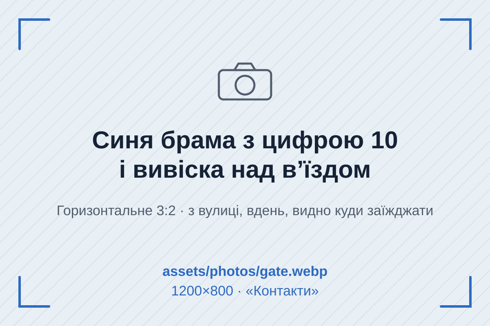

# PHOTOS.md — список кадрів для зйомки

Сім кадрів. Поки фото немає, на їхніх місцях стоять SVG-заглушки з `assets/placeholders/` у кольорах палітри. На кожній заглушці написано, що має бути в кадрі, і вказано назву файлу.

## Загальні правила

- **Формат:** WebP, якість 75–82. Конвертувати можна в [squoosh.app](https://squoosh.app) або командою `cwebp -q 80 in.jpg -o out.webp`.
- **Розмір файлу:** до 250 КБ для горизонтальних кадрів і до 150 КБ для портретів.
- **Пропорції** мають точно збігатися з таблицею, бо в розмітці прописані `width` і `height`. Інакше картинка розтягнеться.
- **Світло:** денне, з відчинених воріт боксу. Жовте лампове світло не годиться: воно сперечається з холодною палітрою сайту.
- **Колір у кадрі:** найкраще пасують сині куртки, сталь і сірий бетон. Яскраво-червоних і зелених плям краще уникати, бо на сторінці вже є два насичені кольори (синій і бурштиновий).
- **Люди:** на портретах дивляться в камеру, у кадрі руки в роботі. Номерні знаки клієнтських авто розмиваємо.

## Кадри

| # | Файл | Що в кадрі | Орієнтація і пропорції | Розмір, px | Де на сайті |
|---|---|---|---|---|---|
| 1 | `work-show.webp` | Майстер біля авто на підйомнику показує клієнтці зняту деталь (стійку стабілізатора, колодку). Видно обличчя обох і деталь у руці. | горизонтальне 3:2 | 1200×800 | «Як ми працюємо», над кроками |
| 2 | `old-parts.webp` | Картонна коробка зі знятими старими деталями на капоті, поруч нові в упаковці. Зверху або під 45°. | квадрат 1:1 | 1000×1000 | «Гарантія», темна смуга |
| 3 | `master-petro.webp` | Петро по пояс біля підйомника, синя робоча куртка, в руці ключ. | вертикальне 4:5 | 800×1000 | «Майстри», перша картка |
| 4 | `master-andrii.webp` | Андрій біля відкритого капота з ноутбуком і сканером. | вертикальне 4:5 | 800×1000 | «Майстри», друга картка |
| 5 | `master-oksana.webp` | Оксана за стійкою приймання, телефон і бланк кошторису. | вертикальне 4:5 | 800×1000 | «Майстри», третя картка |
| 6 | `waiting-room.webp` | Кімната очікування: кавоварка, стілець, велике вікно, крізь яке видно авто на підйомнику. | горизонтальне 4:3 | 1200×900 | «Часті питання», ліворуч |
| 7 | `gate.webp` | Синя брама з великою цифрою 10 і вивіска над в'їздом, знято з вулиці вдень. З кадру має бути зрозуміло, куди заїжджати. | горизонтальне 3:2 | 1200×800 | «Контакти», праворуч |

Бонус, якщо буде час: кадр **1200×630** для соцмереж (наприклад, брама або бокс з авто). Ним можна замінити `assets/og-image.png`, але згенерована картинка з прайс-дошкою вже працює.

## Як вставити фото

1. Покладіть файл у `assets/photos/` під назвою з таблиці (папку створіть, якщо її немає).
2. В `index.html` знайдіть коментар `ФОТО: assets/photos/<назва>.webp` і розкоментуйте рядок `<source>` під ним:

```html
<picture>
  <!-- ФОТО: assets/photos/gate.webp (1200×800) -->
  <source srcset="assets/photos/gate.webp" type="image/webp">
  
</picture>
```

3. За бажання замініть `src` в `` на ту саму WebP-картинку, а заглушки в `assets/placeholders/` видаліть.
4. Перевірте `alt`: він має описувати саме ваше фото.

Перший екран фотографій не має: там табличка й прайс-дошка. Тому всі `` на сторінці мають `loading="lazy"`.
